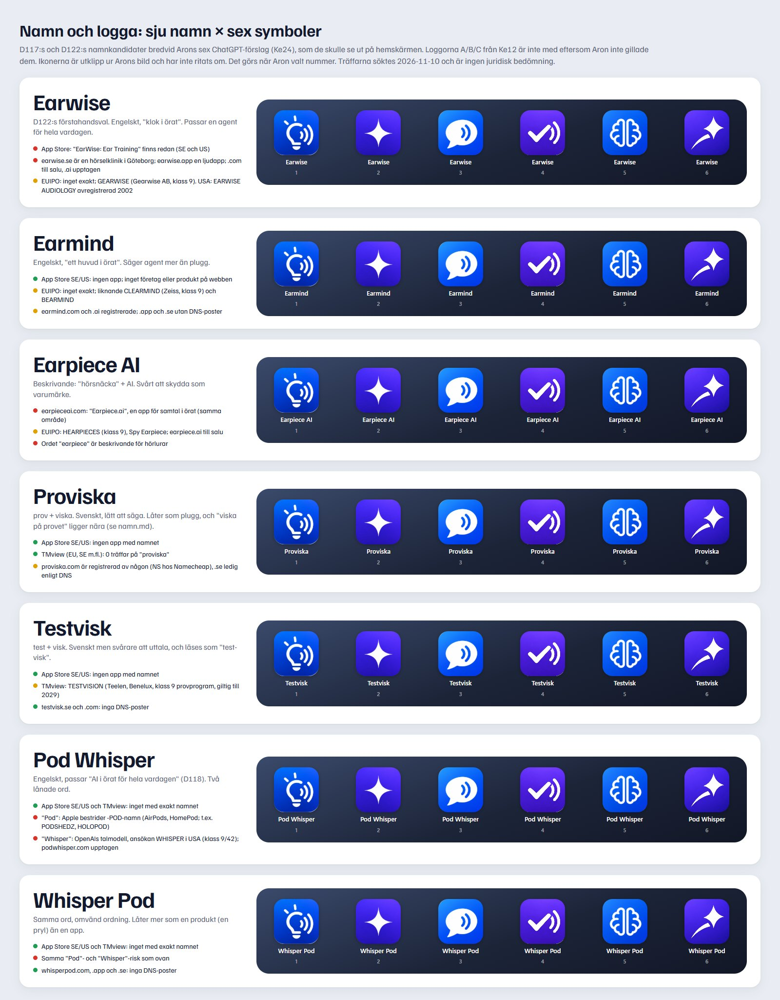
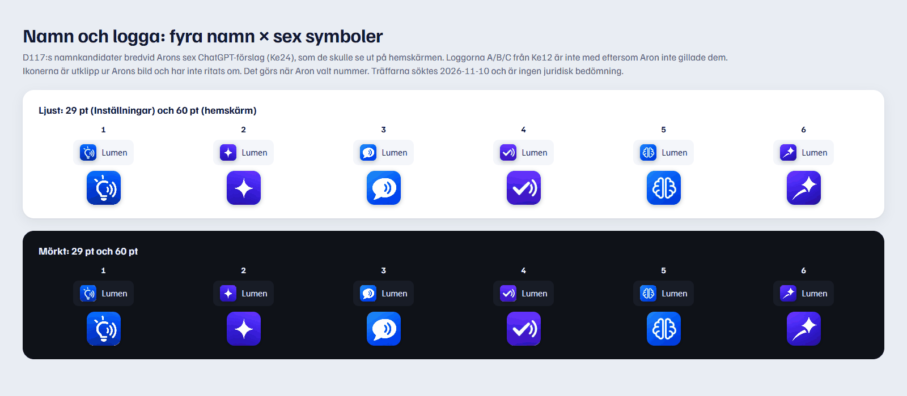

# Namn och logga (Ke23)

Kelly, 2026-11-10. Underlag för Arons val av namn (D117) och logga (Ke24). Inget av det här är beslutat.

## Del 2 (D122, 20:20): Earwise, Earmind, Earpiece AI

Deangelo lade till de här tre 19:57, med Earwise som förstahandsval och "an all-round AI agent in your AirPods".
Sökt 2026-11-10 20:00–20:20.

| Namn | App Store (SE, US) | EUIPO (eSearch, EU-märken) | Webben och domäner |
|---|---|---|---|
| **Earwise** | **"EarWise: Ear Training"** (26 Branding Agency Inc.) finns i båda | Inget exakt. GEARWISE och Gearwise (Gearwise AB, svenskt, klass 9/35/39) innehåller ordet | **earwise.se = Earwise Hörselmottagning Göteborg** (audionomer). **earwise.app = "Earwise – Save it, hear it"**, en app som läser upp artiklar. earwise.com parkerad hos Afternic (troligen till salu). earwise.ai registrerad (GoDaddy, sida utan innehåll). earwise.io: inga poster |
| **Earmind** | Ingen app | Inget exakt. Liknande: ClearMind (Carl Zeiss Vision, klass 9/10), CLEARMIND, BEARMIND (klass 9/10/25/42) | Ingen produkt eller firma hittad på webben. earmind.com registrerad (bakom Cloudflare), earmind.ai registrerad (BytePlus DNS). earmind.app och earmind.se: inga poster |
| **Earpiece AI** | Ingen app med namnet | Inget exakt. HEARPIECES (LIZN ApS, klass 9/10/44), Spy Earpiece (klass 9) | **earpieceai.com = "Earpiece.ai – Stay present. Capture what matters."**, ett minne för samtal i örat (samma område). earpiece.ai är till salu |

USA: EARWISE AUDIOLOGY (hörselvård) avregistrerades 2002, och EARWEISS (Shenzhen, klass 9) är en väntande
ansökan från 2024 (**ej verifierat i USPTO**, bara på aggregatorsidor). **PRV och TMview är inte kontrollerade för
del 2:** TMview spärrade sessionen med "Problem detected" efter del 1, och jag försökte inte ta mig förbi spärren.
EUIPO eSearch täcker EU-märken och internationella märken som gäller i EU, men inte svenska nationella märken.

**Bedömning:**
- **Earwise: rött.** Namnet används redan av en app i App Store, en ljudapp och en svensk hörselklinik, alla
  med öron eller ljud. App Store kräver unika namn, och "Earwise – …" skulle förväxlas med EarWise: Ear Training.
  Användare i Göteborg som söker "Earwise" hamnar hos audionomen.
- **Earmind: grönt till gult.** Det renaste av de nya. Domänerna .com och .ai är tagna, men .app och .se ser lediga
  ut (ej verifierat hos registrar). "-mind" finns i flera märken i klass 9, men inget börjar med "Ear".
- **Earpiece AI: rött.** Ordet är beskrivande (svårt att få ensamrätt till) och en annan AI-produkt för örat heter redan så.

Med D122 (agent för hela vardagen, inte bara plugg) blir rangordningen: **1 Earmind**, 2 Proviska (bara om appen
ska heta något svenskt med plugg i fokus), 3 Whisper Pod. Earwise, Earpiece AI, Pod Whisper och Testvisk avråder jag från.

## Del 1 (D117, 19:32): Proviska, Testvisk, Pod Whisper, Whisper Pod

Bilderna ritas från `docs/design/_src/namn.html` (instruktion överst i filen). Ikonerna är **utklipp ur Arons
ChatGPT-bild** `logo/chatgpt-forslag-2026-11-10.jpg` och har inte ritats om. Loggorna A/B/C från Ke12 är inte med,
eftersom Aron inte gillade dem (Ke24). Ke23 bad om A/B/C, men en tavla med avvisade loggor hjälper inte valet.

## Namnen

Sökningen gjordes 2026-11-10. Det är en snabb koll och ingen juridisk bedömning. En riktig varumärkessökning (eller
ett ombud) behövs innan namnet registreras.

| Namn | Vad det säger | App Store (SE, US) | Varumärken (TMview: EUIPO, PRV och 70+ kontor) | Domän (DNS) |
|---|---|---|---|---|
| **Proviska** | prov + viska. Kort och svenskt, lätt att säga och stava. | Ingen app med namnet | 0 träffar på "proviska". "provisk" ger PROVISKIN (Frankrike, hudvård, klass 3/5/9/42) och ПРОВИСК (Ryssland, klass 5): andra varor | `.com` registrerad av någon (NS hos Namecheap; kan vara Aron, ej verifierat). `.se` och `.app`: inga poster |
| **Testvisk** | test + visk. Läses lätt som "test-visk", och "visk" är inget vanligt ord. | Ingen app med namnet | 0 träffar. "testvis" ger **TESTVISION** (Teelen B.V., Benelux, klass 9: programvara för prov, giltig till 2029) och en upphörd i USA. Lik början, samma varuklass | `.se` och `.com`: inga poster |
| **Pod Whisper** | Engelskt. Passar D118 (AI i örat för hela vardagen) bättre än de svenska. | Ingen app med namnet | Inget med exakt namnet (3 träffar på orden: WHISPERING WOODS … PODCAST, SEX WHISPERS PODCAST, THE PODCAST WHISPERER, alla andra tjänster) | **`podwhisper.com` upptagen** (Cloudflare). `.app` och `.se`: inga poster |
| **Whisper Pod** | Samma ord omvänt. Låter mer som en pryl, en hörlur, än en app. | Ingen app med namnet | Som ovan. "whisperpod" i ett ord: 0 träffar | `.com`, `.app` och `.se`: inga poster |

Källor: iTunes Search API (`itunes.apple.com/search`, `entity=software`, länderna se och us), TMview
(`tmdn.org/tmview`, "innehåller"), `nslookup -type=NS` mot 8.8.8.8. Att en domän saknar DNS-poster betyder
oftast att den är ledig, men inte säkert (**ej verifierat** hos registrar).

### Risker som inte syns i registren
1. **"Pod" och Apple.** Apple bestrider namn som slutar på eller innehåller -POD för elektronik och appar
   (USA: PODSHEDZ 2021, HOLOPOD 2022, THERIGHTPOD 2023; i Kina förlorade Apple mot Huaweis MATEPOD 2021).
   Ihop med "fungerar med AirPods" i annonserna blir likheten med AirPods tydlig. App Store-granskningen
   (5.2.5) stoppar appar som kan förväxlas med Apples produkter. **Verifierat i nyhetskällor, inte i TTAB-akterna.**
2. **"Whisper" och OpenAI.** Whisper är OpenAIs kända taligenkänningsmodell. OpenAI har en varumärkesansökan
   WHISPER i USA (serie 97815511, klass 9 och 42, väntande enligt aggregatorsidor, **ej verifierat i USPTO TSDR**).
   Det finns redan flera appar som heter "Whisper …" (Whisper: AI Assistant, Whisper – Audio to Text, Whisper Mate).
3. **"Viska" och fusk.** Proviska och Testvisk kan läsas som "viska på provet". Det krockar med reglerna för
   marknadsföringen (inget om fusk på prov, R6 i STATUS) och kan väcka frågor från skolor och föräldrar.
   App Store-granskaren läser troligen inte svenska, så risken där är låg, men risken i Sverige är verklig.
   "Whisper" kan läsas på samma sätt, som något hemligt.
4. **Bara plugg.** Proviska och Testvisk säger "prov". D118 säger att Lumen är AI i örat för hela vardagen
   (intervju, socialt, vardag). Ett provnamn gör annonserna för Rizz och vardag svårare.

### Rangordning i del 1 (före D122; se del 2 för den samlade)
1. **Proviska.** Inga krockar i registren, kort och svenskt, och det låter som ett namn och inte en beskrivning.
   Nackdelar: läsningen "viska på provet" och att det bara säger plugg. Kontrollera vem som äger `proviska.com`.
2. **Whisper Pod.** Passar D118 och domänerna verkar lediga, men "Pod" och "Whisper" är båda lånade från större
   varumärken. Välj det bara om ett ombud har tittat på Apple-risken.
3. **Pod Whisper.** Samma risker, och `.com` är upptagen.
4. **Testvisk.** Likt TESTVISION i samma klass och svårare att säga.

Ingen av de fyra är helt ren. Vill Aron ha ett namn som passar hela vardagen utan lånade ord kan jag ta fram fler
kandidater med samma kontroll. Det är Arons beslut och ingen punkt i kön.

## Symbolerna (underlag för Ke24)

| Nr | Vad | 29 pt | Risk |
|---|---|---|---|
| 1 | Glödlampa med ljudvågor | Lampans detaljer och vågorna flyter ihop | Låg. Glödlampan är vanlig i pluggappar |
| 2 | Fyruddig stjärna ("AI-gnistan") | Tydlig | **Hög förväxling:** samma form som Google Geminis ikon och den vanliga AI-symbolen. Säger "någon AI-app" |
| 3 | Pratbubbla med ljudvågor | Tydlig | **Lik Apples Meddelanden** (vit bubbla på färg). Granskningsrisk (5.2.5) och förväxling |
| 4 | Bock med ljudvågor | Tydlig, bocken syns även i 29 pt | Låg. "Rätt svar i örat", fungerar även för vardag (rätt sak att säga) |
| 5 | Hjärna | Lobernas linjer blir en klump i 29 pt | Låg men generisk. Hjärnan används av många pluggappar |
| 6 | Stjärna med svans | Tydlig | Samma AI-gnista som 2 |

**Rekommenderar 4** (bock med ljudvågor). Den är egen, läsbar i 29 pt, säger både "rätt" och "i örat" och passar
ihop med alla namnen. Med D122:s agentriktning (göra saker åt dig) passar en bock också: "klart". Om Aron väljer 1 eller 5: förenkla linjerna när de ritas om, så att de håller i 29 pt.
Ingen av de sex visar en hörlur, så ingen är Apple-lik på det sättet.

Färgerna i ChatGPT-förslagen (blå–lila toning) stämmer inte med SYSTEM.md (en accent, #2346C8). Vid omritningen
i Ke24 blir ikonen accentblå, med en lätt toning inom samma blå, om inte Aron vill ha lila.
