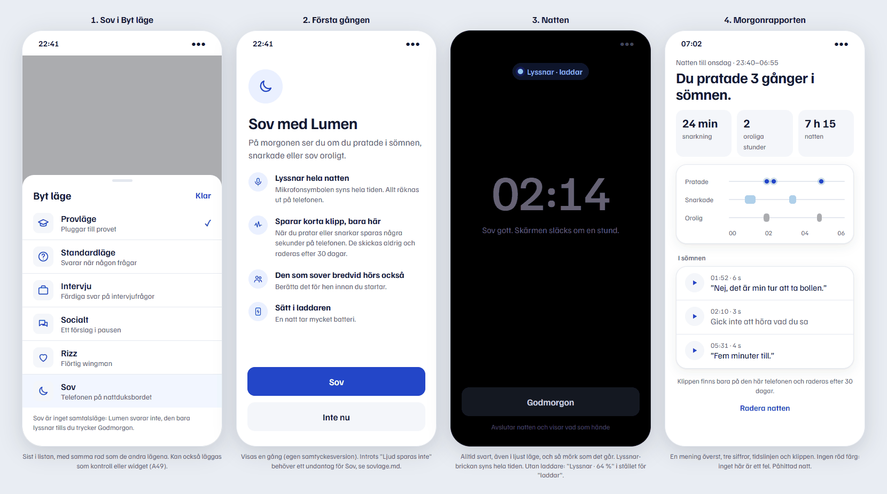
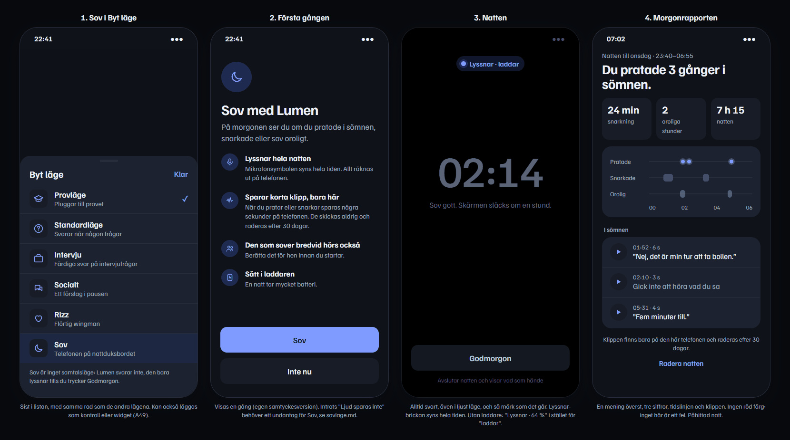

# Sömnläget: start, natten och morgonrapporten (Ke27, D123, till A49)

Kelly, 2026-11-10. Underlag för Angelas A49. Ritat i `_src/sovlage.html` (påhittad natt).

## Princip
En knapp "Sov", inget att ställa in (D123). Allt avancerat (VAD, ljudklassning, taligenkänning) syns aldrig.
Samma system som resten av appen (SYSTEM.md): en accent, inga röda färger utom i raderingsdialogen, Familjen Grotesk.

## 1. Var man startar
- **Byt läge-bladet** (med "Klar" uppe till höger, som i appen): en sista rad "Sov" med en måne och raden "Telefonen på nattduksbordet". Under listan står en
  rad: "Sov är inget samtalsläge: Lumen svarar inte, den bara lyssnar tills du trycker Godmorgon."
- Kontroll eller widget enligt A49, med samma ikon och ord.
- Sov hör inte till D97:s två knappar på provkortet och ska inte synas på Start förrän det finns en natt att visa.

## 2. Första gången (egen samtyckesversion, t.ex. `sleep-1`)
Rubrik **"Sov med Lumen"**, och raden "På morgonen ser du om du pratade i sömnen, snarkade eller sov oroligt."
Fyra punkter:
1. **Lyssnar hela natten.** Mikrofonsymbolen syns hela tiden. Allt räknas ut på telefonen.
2. **Sparar korta klipp, bara här.** När du pratar eller snarkar sparas några sekunder på telefonen. De skickas aldrig och raderas efter 30 dagar.
3. **Den som sover bredvid hörs också.** Berätta det för hen innan du startar.
4. **Sätt i laddaren.** En natt tar mycket batteri.

Huvudknapp **"Sov"**, sekundär **"Inte nu"**. Efter första gången startar "Sov" direkt.

## 3. Natten
- **Alltid svart** (#000), även i ljust läge. Det är sovrummet, och OLED-skärmen drar minst ström så.
- Lyssnar-brickan överst, hela tiden: "Lyssnar · laddar", eller "Lyssnar · 64 %" utan laddare. Ingen varning i rött;
  utan laddare räcker siffran.
- En stor dämpad klocka (#5B6377 på svart) och raden "Sov gott. Skärmen släcks om en stund." Skärmen får låsa sig som
  vanligt, och lyssnandet fortsätter i bakgrunden (iOS visar sin mikrofonsymbol).
- En knapp, **"Godmorgon"**, med raden "Avslutar natten och visar vad som hände". Inga andra knappar och ingen paus.
- Glömmer man trycka: natten avslutas av sig själv efter 12 timmar (förslag), och rapporten visas nästa gång appen
  öppnas.

## 4. Morgonrapporten
Uppifrån och ned, ingenting mer:
1. Liten grå rad: "Natten till onsdag · 23:40–06:55".
2. **En mening** (28 pt halvfet):
   - 0 gånger: "Du pratade inte i sömnen."
   - 1 gång: "Du pratade en gång i sömnen."
   - N: "Du pratade N gånger i sömnen."
3. **Tre siffror** i brunnar: snarkning i minuter ("24 min"), oroliga stunder ("2"), nattens längd ("7 h 15").
   0 visas som "0 min" respektive "0", aldrig som ett streck.
4. **Tidslinjen** i ett kort, med tre rader: Pratade (prickar i accentfärgen), Snarkade (block i accent 35 %),
   Orolig (block i grått 45 %). Axeln visar varannan timme. Prickarna går att trycka på och spelar klippet.
5. **"I sömnen"**: ett kort med en rad per gång. ▶, tid och längd ("01:52 · 6 s") och det som sades ordagrant
   inom ”…”. Gick det inte att känna igen: "Gick inte att höra vad du sa" i grått, och klippet finns ändå.
   Snarkningar listas inte som klipp (de syns i tidslinjen), så listan blir inte lång.
6. Grå rad: "Klippen finns bara på den här telefonen och raderas efter 30 dagar."
7. Länk **"Radera natten"**. Den öppnar iOS dialog "Radera natten? Klippen och texten försvinner." med
   "Radera" (destruktiv, röd som iOS gör) och "Avbryt".

Rapporten hamnar i Historik. På Start visas ett kort "I natt: Du pratade 3 gånger i sömnen" tills det har öppnats en gång.

## Konflikt som måste lösas innan A49 släpps (till Angela och Deangelo)
Introt säger **"Ljud sparas inte"**, och samtycket (A41) säger **"Lumen sparar aldrig ljud"**. Det gör även
App Store-utkastet (Ke25) och demosidan. Sömnläget sparar klipp på telefonen, så meningarna blir osanna.
Förslag:
- Intro: "Ljud sparas inte" → **"Ljud sparas inte, utom klippen i Sov"**. Alternativt kan raden stå kvar oförändrad
  om Sov-klippen räknas som något användaren själv har valt i steg 2. Det är Deangelos beslut, eftersom det rör
  samtyckestexten.
- Samtycket (A41): lägg till en mening i "Talet skrivs ut …": "I Sov sparas korta klipp bara på telefonen."
  Det betyder en ny samtyckesversion.
- Integritetsetiketter (Ke25): klippen lämnar aldrig telefonen, så de räknas inte som insamlade enligt Apples definition.

## Utanför det här
- Väckarklocka och "smart väckning": nej, inget att ställa in (D123).
- Inga sömnpoäng eller betyg: vi mäter inte sömn, bara ljud.
