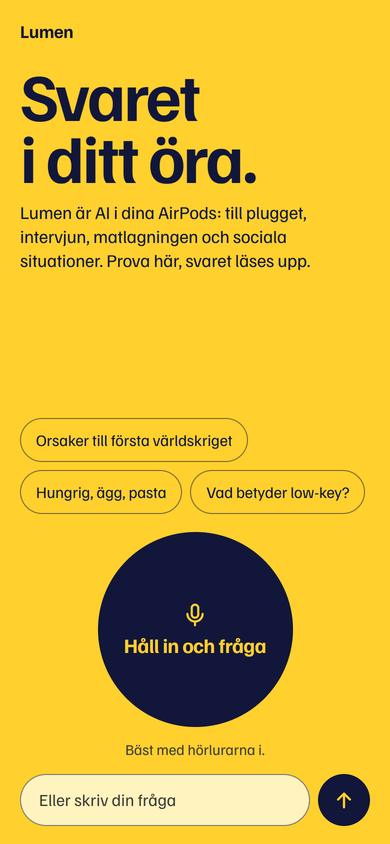
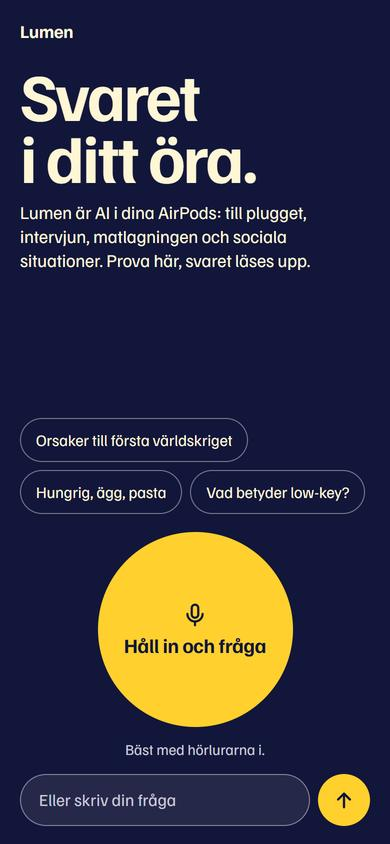
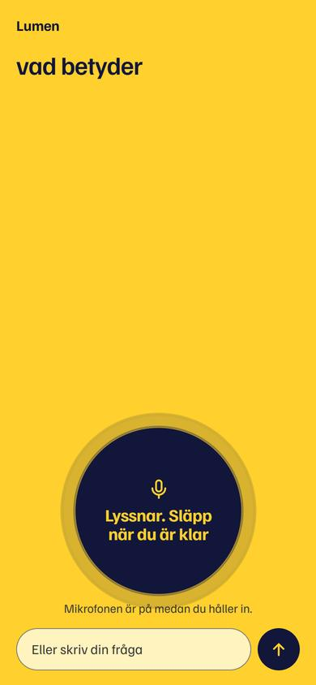
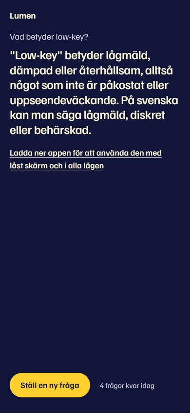
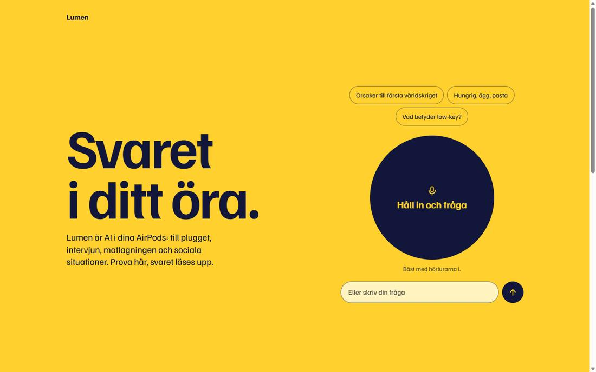
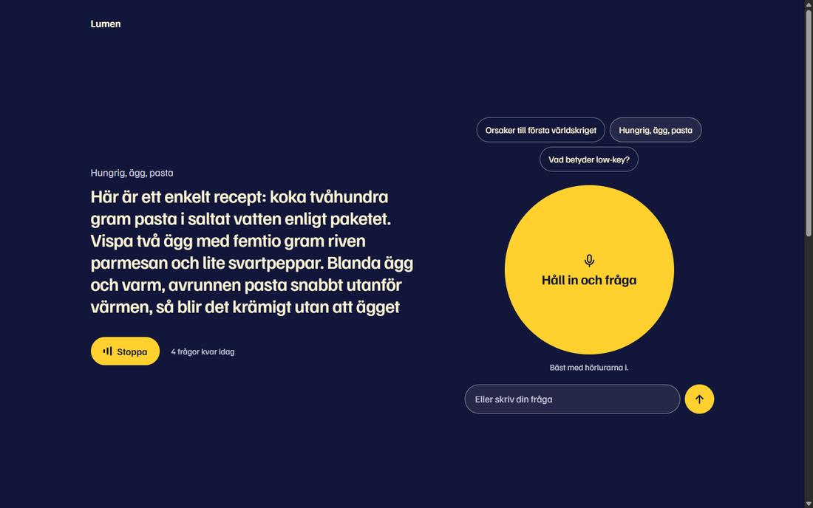

# Offentlig demosida (D62), Kelly Kapoor

## Klart
Demosidan finns i `site/`: en fil (`index.html`) plus ett självhostat typsnitt. Inga bibliotek, inget byggsteg. Allt i uppdraget finns med: rubrik och pitch, "Håll in och fråga", textruta, svar som text och uppläst, tre exempelfrågor, de tre lägena som "Kommer i appen", nedladdningstexten och väntelistan med samtycke och integritetstext. Namnet byts på ett ställe, `APP_NAME` överst i filen.

**Sidan är inte publicerad.** Den ska inte heller publiceras innan punkterna under "Måste lösas före lansering" är klara.

| Mobil, ljust | Mobil, mörkt | Lyssnar | Svar |
|---|---|---|---|
|  |  |  |  |

Fler bilder i `reports/assets/2026-11-06-kelly-demo-site/` (hela sidan, mobil och desktop).

## Design
- **Idé:** ljust och mörkt läge är varandras inversion. Solgul sida med bläckblå skiva, eller bläckblå sida med tänd gul skiva. Väntelistan inverteras igen, så den står ut i båda lägena.
- **Det minnesvärda är skivan:** den reagerar på rösten, skickar ut ringar och är också den synliga lyssningsindikatorn. Resten är tyst: en familj (Familjen Grotesk), inga kort, ingen dekoration.
- **Svaret tar över skärmen:** skivan står still när du håller in, eftersom intro och samtal delar samma ruta. Orden tonar in medan svaret strömmar. Stoppa och "Ställ en ny fråga" sitter vid tummen.
- **ui-ux-pro-max:** designsystemet föreslog röd färg, Inter och Swiss-stil, vilket är generiskt för ett AI-verktyg. Jag behöll bara mönstret med demon först och tillgänglighetsreglerna.

## Teknik
- Återanvänd från `backend/webtest/index.html`: anonym inloggning, `/answer` via SSE, `/tts` per mening spelad i `<audio>`, Scribe via `/stt-token`, Safari som reserv, Apples röst om `/tts` fallerar.
- **Ändrat mot webtest:**
  - Uppvärmning med `OPTIONS` i stället för `GET`, som gav 405 i konsolen. `x-warm` stoppas av CORS i webbläsaren.
  - Scribe-token hämtas först när besökaren rör sidan, eftersom de är begränsade till 600 per dag globalt. Saknas token när man håller in köas ljudet.
  - Släpper man medan telefonen frågar om mikrofonen får man en tydlig uppmaning, och mikrofonen stängs direkt.
  - Fel visas på vanlig svenska, utan felkoder.
  - Frågor som misslyckas räknas inte av de fem.
- **Väntelistan:** skickar `POST /waitlist` med `{ "email", "consent": true, "source": "demo-site" }`. Svaren 2xx och 409 räknas som klart.
- **Sidvikt:** `index.html` 45 kB (14 kB gzip) plus typsnitt 19 kB. Ingen anropar Google eller annan tredje part utöver Supabase, ElevenLabs (Scribe) och sidan själv.

## Testresultat
Testat i Playwright/Chromium på Windows. **Ingen riktig iPhone, Safari eller AirPods har använts.**

| Vad | Resultat | Status |
|---|---|---|
| Riktig fråga via exempelknapp (tre frågor) | Första text efter ca 1,0 s, `/tts` 200, ljudet spelades klart | **verified live, Chromium** |
| Stopp mitt i ett riktigt svar | Avbröt svar och uppspelning, texten stod kvar | **verified live, Chromium** |
| `/stt-token` | Svarar 200 med token (D44-behörigheten verkar löst) | **verified live, curl** |
| `/waitlist` mot riktig backend | Finns inte. Rätt meddelande, adressen står kvar | **verified live, Chromium** |
| Håll in med Scribe | Flödet fungerar | mockad mikrofon och WebSocket, **riktig Scribe otestad** |
| Safari-reserven | Flödet fungerar | mockad igenkänning, **riktig Safari otestad** |
| Nekad mikrofon, för kort tryck, långsam tillståndsruta | Rätt meddelande, inga JS-fel | mockat |
| 429, 503, nätverksfel, stopp och ny fråga, gräns 5 frågor | Rätt meddelande, felen räknas inte | mockat |
| Väntelista: validering, 200, 404 | Rätt | mockat, utom raden ovan |
| Layout 320, 360, 390, 768, 1440 px, ljust och mörkt | Ingen sidledsscroll | **verified, emulering** |
| Tangentbord | Tabbordning och håll in med mellanslag fungerar | **verified, Chromium** |
| Reducerad rörelse | Animationer av | **verified, Chromium** |
| Kontrast | Minst 6,2:1 på all text | **beräknat** |

**Kvar att testa på riktig iPhone + AirPods:** håll in utan att sidan scrollar eller markerar text, tillståndsrutan för mikrofonen, att ljudet går ut i AirPods efter mikrofonen, ringknappen, tangentbordet över textrutan, safe areas. Allt detta är **untested assumption**.

## Måste lösas före lansering
1. **Gränserna i D62 finns inte på servern.** Sidan räknar fem frågor i webbläsaren, och det kringgås genom att rensa lagringen. Servergränsen är fortfarande 400 per dag per användare. Kevin behöver en demogräns per besökare och ett globalt tak.
2. **Webbsökning går inte att stänga av från sidan.** `/answer` söker själv vid till exempel "sök" eller aktuella fakta. D62 säger ingen webbsökning, så backend behöver en demoflagga. Kevin bör också bekräfta att demon alltid går på Haiku.
3. **`/waitlist` finns inte än.** Kevin behöver godkänna fälten ovan och tillåta `content-type` i CORS.
4. **Integritetstexten behöver ansvarig och kontaktväg.** Den saknar vem som är personuppgiftsansvarig. Jag har inte lagt in någon adress utan att fråga. Kevin måste också bekräfta att löftet stämmer: e-post sparas bara tills appen finns och tas bort på begäran.
5. **GitHub Pages kan inte publicera `site/` direkt.** Från gren går bara roten eller `/docs`, så det krävs ett Actions-arbetsflöde, och Aron måste slå på Pages. Jag har inte gjort något av det, eftersom uppdraget gällde bara `site/`.

## Concerns
- **Provläge i offentlig text:** "prov" kan läsas som hjälp under prov, och R6 säger ingen provanvändning i marknadsföringen. Rubriken "Svaret i ditt öra" förstärker den läsningen. Jag beskriver läget som plugg och behöll namnet, men Architect bör ta ställning.
- **"Inget ljud sparas" stämmer inte fullt ut.** ElevenLabs nollretention gäller inte på vår plan. Texten säger därför att vi inte sparar något, men att leverantörerna kan behålla data enligt sina villkor.
- **Rizzläge:** beskrivs som förslag i vardagssamtal, utan formuleringar om att ingen märker det.

## Kända begränsningar
- Svaren kommer i talform, så siffror står utskrivna ("nittonhundrafjorton") i texten.
- Modellen skriver raka citattecken, och det syns i stor text.
- På 320 × 568 hamnar textrutan 7 px under vecket. Skivan syns.
- Sidan pushas under `site/`, som inte finns i `paths-ignore`, så varje ändring startar iOS-bygget i onödan. Filen `.github/workflows/ios-build.yml` ligger utanför min mapp.

## Beslut
D63 i `docs/DECISIONS.md`: självhostat typsnitt (Familjen Grotesk, OFL) och vänlig gräns i webbläsaren tills servern har sin.

## Nästa session
1. Kevin: `/waitlist`, demogräns och global tak, demoflagga utan webbsökning.
2. Deangelo/Architect: svara på Concerns, bestäm Pages-arbetsflöde, lägg till `site/**` i `paths-ignore`.
3. Aron: testa på iPhone med AirPods, ange personuppgiftsansvarig och kontaktväg.
4. Kelly: justera efter telefontestet, testa med riktig Scribe.
