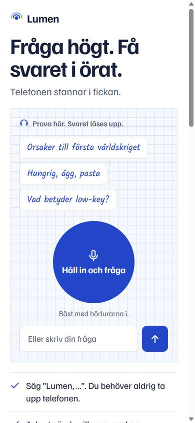
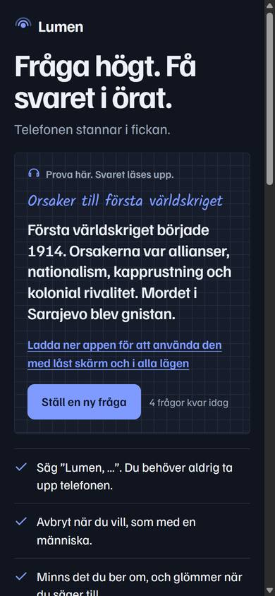
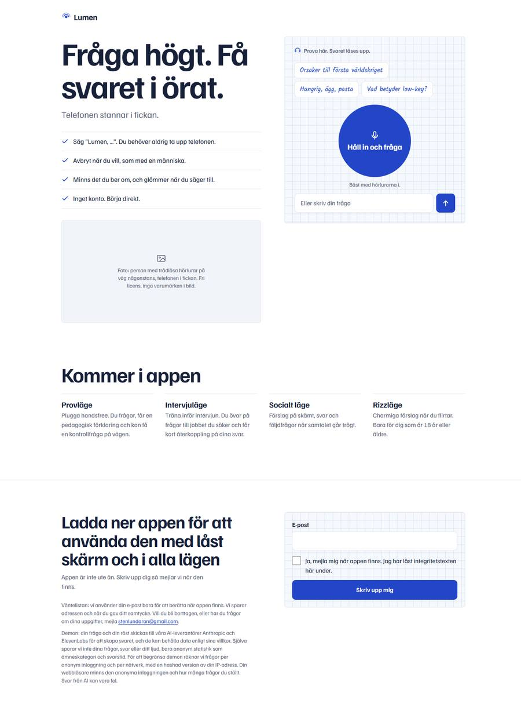
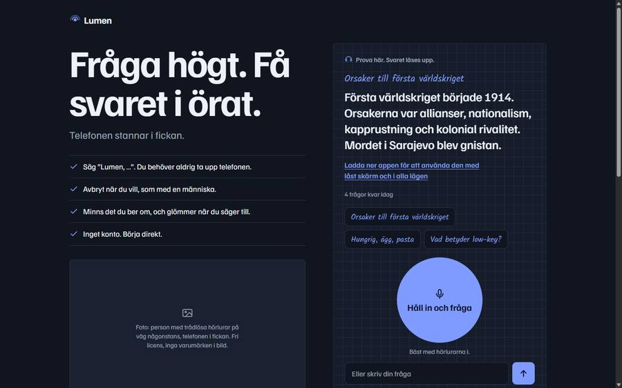

# Demosidan i appens nya design (D86), Kelly Kapoor

Underlag: Arons uppdrag 2026-11-08 och skisserna https://claude.ai/artifact/UZeuuk1zxGMKVA6A9CQC1x (färger och typsnitt från "Start", "Lyssnar" och "Öppnar appen", ljust och mörkt).

## Gjort
- **Typsnitt:** Familjen Grotesk överallt. Handstilen Kalam används bara för frågor i demon: exempelfrågorna och frågan som visas ovanför svaret. Kalam ligger lokalt i `site/fonts/kalam.woff2` (latin, 22 kB) med licensen `site/fonts/OFL-Kalam.txt` (SIL OFL 1.1). Sidan hämtar inget från Google, så besökarens IP-adress skickas inte dit.
- **Färger från skisserna:** blå #2346C8 för knappar och frågor, röd #D9342B för Stoppa-knappen. Felmeddelanden använder en mörkare röd (#B8261E), eftersom #D9342B på rutat papper bara ger ungefär 4,4:1 i kontrast. Mörkt läge använder skissernas mörka värden (blå #7F9BFF, röd #FF6F61). Ljust eller mörkt följer systemet.
- **Rutat papper** bakom demorutan och väntelistans formulär (rutor om 18 px, 22 px på dator).
- **Texter:**
  - Rubrik: "Fråga högt. Få svaret i örat."
  - Undertext: "Telefonen stannar i fickan."
  - Fyra punkter, exakt som beställt. "Lumen" i första punkten hämtas från `APP_NAME`.
  - Sidtitel och delningstexter är uppdaterade.
  - Inget om svarstid i sekunder, och inget om att ljud aldrig lämnar telefonen. Integritetstexten säger fortfarande att rösten skickas till ElevenLabs.
- **Platshållare för foto** med en beskrivning av bilden: "person med trådlösa hörlurar på väg någonstans, telefonen i fickan. Fri licens, inga varumärken i bild." I HTML-koden finns en kommentar om att byta ut den.
- **Layout:**
  - Mobil: rubrik, demon, punkterna, fotot, "Kommer i appen", väntelistan.
  - Dator: rubrik, punkter och foto till vänster, demon till höger (följer med när man skrollar).
- **Allt i demon fungerar som förut:** samma id:n och samma skript. Bara utseendet och texterna är ändrade. Tak-texter, uppläsning, håll in och väntelistan är orörda.

| Mobil ljust | Mobil mörkt, svar |
|---|---|
|  |  |

| Dator ljust, hela sidan | Dator mörkt, svar |
|---|---|
|  |  |

## Testresultat
| Vad | Resultat | Status |
|---|---|---|
| 390×844 ljust och mörkt, 1440×900 ljust och mörkt, 320×640 | Ingen sidledsskroll. Textrutan syns på första skärmen på alla. | **verified, Chromium** |
| Kalam laddad, används av exempelfrågor och fråga | `document.fonts.check` gav true; frågorna visas i Kalam | **verified, Chromium** |
| Exempelfråga till svar (mockad `/answer`) | Frågan visas i Kalam, svaret strömmas, "Ställ en ny fråga" och räknaren visas. Inga JS-fel (bara de mockade 500-svaren från `/tts`). | mockat, Chromium |
| Arbetsflödets filkontroll (lokala filer, inga absoluta sökvägar, storlek) | Godkänt, 116 kB | **verified** (samma kontroll som i `pages.yml`, lokalt) |
| iPhone, Safari, AirPods | Inte testat | **untested assumption** |

## Kända begränsningar
- Fotot är en platshållare. Det behövs ett riktigt foto med fri licens och utan varumärken i bild.
- Kalam har bara latinska tecken (åäö finns). Om ett tecken saknas används systemets handstil eller ett vanligt typsnitt.
- Ändringen i `site/` publiceras av sig själv när Pages är påslaget. Pages var av när jag senast kollade.

## Publicerad (tillägg samma dag)
Aron slog på Pages. Jag startade arbetsflödet manuellt: run 42486945392, där både `check` och `deploy` blev gröna (**verified on GitHub Actions**). Kontroll av https://aronstenlund-code.github.io/aronstenlund-airpods-ai/ i Chromium:
- Sidan svarar 200 och har den nya rubriken.
- Båda typsnitten laddas (200, `font/woff2`).
- Backend tillåter adressen (CORS-förfrågan gav 204 med rätt ursprung).
- Exempelfrågan "Vad betyder low-key?" gav `signup`, `answer` och två `tts`, alla med svar 200. Första texten kom efter 0,9 s, och inga JS-fel uppstod.

Allt detta är **verified, Chromium på Windows, live**. Testet förbrukade en av dagens demofrågor.

## Nästa session
1. Någon: lägg in ett riktigt foto i stället för platshållaren.
2. Oscar eller Kelly: testa sidan i Safari på iPhone, i ljust och mörkt läge.
