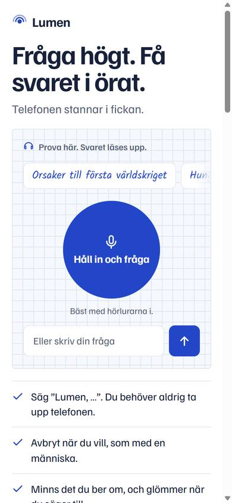
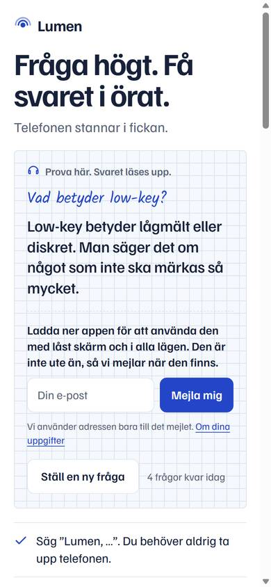
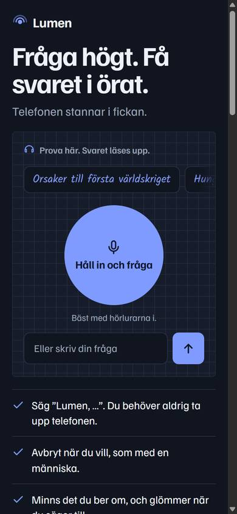
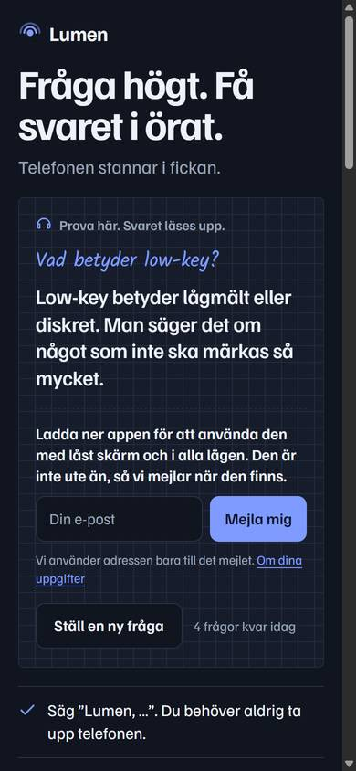
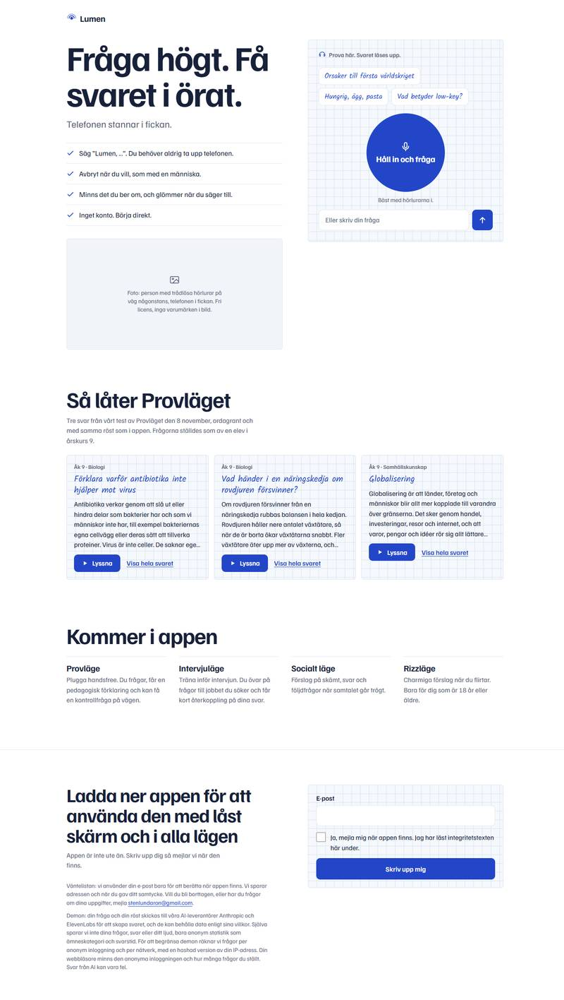
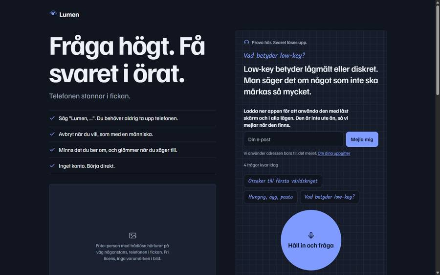

# Ke1: demosidan från bra till mycket bra, Kelly Kapoor

Kö: `prompts/queue/kelly.md`, punkt Ke1. Live: https://aronstenlund-code.github.io/aronstenlund-airpods-ai/ (commit `36baa0f`, Pages-run 42493603126 grön).

## Gjort
1. **Mobil först, inga layoutskift**
   - På mobil (under 720 px) ligger exempelfrågorna på en rad som går att svepa, med en tonad kant till höger som visar att det finns fler. Knappen "Håll in och fråga" och textrutan syns nu på första skärmen även på 320×640. På 390×844 slutar textrutan vid 598 px; förut låg den vid 702 px.
   - Reservtypsnitt med samma mått som webbtypsnitten: Arial/Helvetica med `size-adjust` och ascent/descent uträknade ur typsnittsfilerna, för både Familjen Grotesk och Kalam. Rubriken och exempelfrågorna bryter då på samma ställe innan typsnitten har laddats.
   - Layoutskift (CLS) med typsnitten fördröjda 0,9 s: 0,0000 på 390 px och högst 0,0003 på 768, 1024 och 1440 px. Före ändringen var det 0,017–0,019 på dator.
   - Efter ett svar är knappen "Ställ en ny fråga" ljus. Den blå knappen är väntelistan.
2. **Tre riktiga exempel från Provläget** (avsnittet "Så låter Provläget").
   - Exemplen är tagna ordagrant från D87-testbanken (`reports/eval/provlage-2026-11-08-haiku-structure2-sample.json`): pl-019 antibiotika och virus, pl-022 näringskedja utan rovdjur, pl-079 globalisering. Alla tre gäller årskurs 9 och kör på Haiku med den driftsatta svarsstrukturen. Domaren gav full poäng på alla fem kriterierna och hade inga anmärkningar.
   - Skriptet som bygger sidan läser svaren direkt ur filen, så ingen text är avskriven för hand. Det jag har ändrat i frågorna är stor första bokstav, och ett frågetecken på pl-022.
   - Ljudet är inspelat i förväg med `/tts` (samma standardröst som appen, `mp3_22050_32`, cirka 45 s och 170 kB per svar). Filerna ligger i `site/audio/`. Att spela dem kostar inget anrop och tar inget av besökarens demotak. Ljudet hämtas först när man trycker på Lyssna.
   - Svaren visas kortade till fem rader, med knappen "Visa hela svaret". Lyssna-knappen blir "Stoppa" medan ljudet spelas. Demon och exemplen stoppar varandra.
3. **Väntelistan direkt efter demon:** under svaret visas en rad med ett e-postfält och knappen "Mejla mig". Texten ovanför är kravtexten "Ladda ner appen för att använda den med låst skärm och i alla lägen", följd av "Den är inte ute än, så vi mejlar när den finns."
   - Under fältet står "Vi använder adressen bara till det mejlet", med en länk till integritetstexten.
   - Den här raden skickar `consent_version: "2026-11-08-rad"`. Stora formuläret längre ner har kvar sin kryssruta och `2026-11-06`.
   - Samtycket här är att man själv skriver in sin adress och trycker på en knapp som säger vad som händer. Det finns ingen kryssruta, eftersom uppgiften krävde ett fält. Se Concerns.
4. **Delningsbild och ikoner**
   - `og.png` är 1200×630 och 17 kB: rutat papper, Lumen-ringarna, rubriken och undertexten.
   - Sidan har `og:url`, `og:image` med mått och alt-text, `og:locale sv_SE` och `twitter:card summary_large_image`.
   - Ikoner: `favicon.svg` med ringarna (byter till mörk när datorn är i mörkt läge), `favicon-32.png` och `apple-touch-icon.png` (180 px).
5. **Sidvikt och laddtid**, mätt på den riktiga adressen i Chromium med 390 px bredd och utan cache:

| | Värde |
|---|---|
| HTML (komprimerad) | 18,6 kB |
| Allt som laddas vid start (HTML och två typsnitt) | **61 kB**, tre filer plus favicon |
| Inga bibliotek, inget från Google, inga bilder i första vyn | ja |
| Första innehållet syns (FCP), utan strypning | 64 ms |
| FCP på Slow 4G (1,6 Mbit/s, 150 ms) | 332 ms, allt klart vid 597 ms |
| FCP på 3G (750 kbit/s, 300 ms) | 520 ms, allt klart vid 1 141 ms |
| Layoutskift (CLS), live | 0 utan strypning, 0,003 på Slow 4G |
| Hela `site/` på disk, inklusive ljudet | 673 kB |

   Första mätningen gav 3 s, men 2 s av det var namnuppslaget (DNS) på den här datorn i ett helt nytt webbläsarfönster. Siffrorna ovan räknar inte med namnuppslaget. (**verified, Chromium på Windows, live**; strypningen är Chromes egen och ingen riktig mobilanslutning.)
6. **Inga påståenden om svarstid i sekunder**, och inget om att ljud aldrig lämnar telefonen. Jag kontrollerade sidan med grep efter "sekund" och "lämnar telefonen" och hittade inget. Exemplen innehåller inga sådana påståenden.

| Mobil ljust | Mobil ljust, efter svar | Mobil mörkt | Mobil mörkt, efter svar |
|---|---|---|---|
|  |  |  |  |

| Dator ljust, hela sidan | Dator mörkt, efter svar |
|---|---|
|  |  |

Delningsbilden: 

## Testresultat
| Vad | Resultat | Status |
|---|---|---|
| 320, 390, 768, 1024 och 1440 px, ljust och mörkt | Ingen sidledsskroll. "Mejla mig" ligger inne i rutan. | **verified, Chromium** |
| Layoutskift med fördröjda typsnitt | 0 till 0,0003 | **verified, Chromium** |
| Exempel: Visa hela svaret, Lyssna, Stoppa | `aria-expanded` växlar. Ljudet spelar 44,6 s, och Stoppa stoppar det. | **verified, Chromium** (ljudet spelat lokalt; filerna svarar 200 live) |
| Väntelisteraden: fel adress, sedan rätt | Felet visas. Rätt adress skickar `{email, consent:true, consent_version:"2026-11-08-rad", source:"demo", website:""}` och visar "Klart". | mockat `/waitlist`, Chromium |
| Delningsbild, ikoner och ljudfiler live | Alla svarar 200 med rätt typ | **verified, live** |
| Förhandsvisning i Messenger, Snapchat och iMessage | Inte testat; kräver att någon delar länken | **untested assumption** |
| iPhone, Safari, AirPods | Inte testat | **untested assumption** |

## Concerns
- **Samtycke utan kryssruta på väntelisteraden.** Rutan säger vad som händer, man skriver själv in adressen och trycker på "Mejla mig". Länken går till integritetstexten och versionen sparas separat. Jag bedömer att det är ett aktivt samtycke för ett enda syfte (**untested assumption**, ingen jurist har läst det). Vill Aron eller Deangelo ha en kryssruta även här är det en rad att lägga till.
- **Exemplen är Haiku-svar från ett test.** De är riktiga och fick full poäng, men de är utvalda bland de bästa. Texten på sidan säger att de kommer från ett test den 8 november. Siffror skrivs ut som ord, eftersom svaren är skrivna för att läsas upp. Jag valde exempel utan siffror.
- Ljudet till exemplen kostade tre `/tts`-anrop på cirka 2 000 tecken totalt, en gång.

## Kvar
- Riktigt foto i stället för platshållaren.
- Testa i Safari på iPhone (svepraden, Lyssna och låst skärm) och dela länken en gång i iMessage eller Messenger för att se förhandsvisningen.
