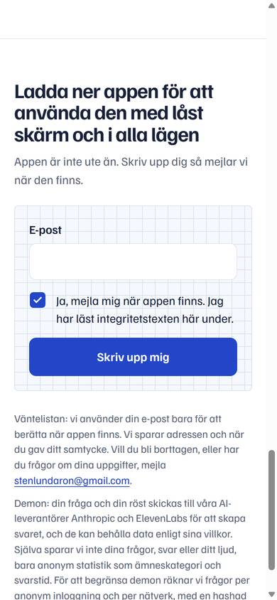
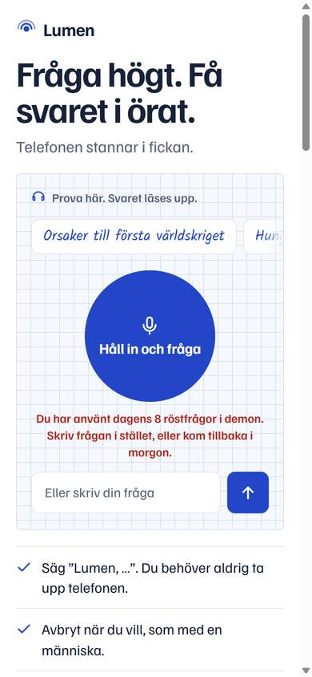

# Ke2: Oscars fynd på demosidan, Kelly Kapoor

Underlag: `reports/qa/2026-11-08-1630-oscar-demosida.md`, fynd 1, 2 och 4. Fynd 3 (språkfel i Haiku-svaren) är Kevins. Fynd 5 gällde Oscars egen skärmbild.

## Gjort
1. **Fokus efter en fråga** (fynd 1)
   - När det man tryckte på försvinner eller tappar fokus hamnar fokus på svaret (`#a`, `tabindex="-1"`). Det gäller till exempel textrutan, som stängs efter Enter, en exempelfråga på mobil, där kontrollerna göms, och knappen Stoppa när den göms.
   - Fokus flyttas när svaret börjar, när svaret är klart och när ett tak nås.
   - Nästa Tab går till e-postfältet på väntelisteraden och sedan till "Ställ en ny fråga".
   - Är det man tryckte på fortfarande synligt, till exempel en exempelfråga på dator, står fokus kvar där.
   - Svaret får en fokusram bara vid tangentbordsanvändning (`:focus-visible`). `aria-live="polite"` på svaret är kvar.
2. **Träffytor på minst 44×44 px** (fynd 2)
   - Samtyckesrutan är nu ritad med CSS: rutan syns som 22 px, men själva kryssrutan är 44×44 px. Bocken har färgen `--on-blue`, så den syns i både ljust och mörkt läge.
   - Mejllänken i integritetstexten och länken "Om dina uppgifter" har 12 px utfyllnad uppåt och nedåt och lika stor negativ marginal. Träffytan är 46 respektive 44 px hög, och raderna ligger där de låg förut.
3. **Taket för tal, hur det provats** (fynd 4), se nedan.

## Taket för tal: så har det provats
- **D79/D80 (07–08 nov), med mockat svar:** Playwright gav sidan ett påhittat 429-svar med `demo_limit_visitor` från `/stt-token`. Sidan visade serverns text, slutade lyssna och gjorde inga fler `/stt-token`-anrop vid nästa tryck. Jag släppte efter 0, 150 och 300 ms utan JS-fel. Det provade sidans hantering, inte serverns tak.
- **I dag, mot den riktiga servern:**
  - Lokal sida (`localhost:5180`, som backend tillåter) mot driftsatt backend, i Chromium, 390×844. Ny anonym besökare.
  - Mikrofonen ersattes av en ton på 220 Hz (`getUserMedia` gav en `MediaStream` från en oscillator).
  - Tio tryck på 0,9 s med 3,6 s väntan. Före varje tryck nollställdes sidans `scribeOff`, eftersom en tyst ton aldrig ger någon text och sidan annars byter till webbläsarens egen taligenkänning. Det var därför Oscars nio tryck bara gav två `/stt-token`-anrop.

| Tryck | `/stt-token` | Sidan |
|---|---|---|
| 1–7 | 200 | "Hörde ingenting. Försök igen." (tonen har inga ord) |
| 8–9 | 429 `rate_limited` "Too many token requests", `fallback:true` (gränsen 6 per minut) | Byter till webbläsarens taligenkänning, som det är tänkt |
| 10 | 429 `demo_limit_visitor` | **"Du har använt dagens 8 röstfrågor i demon. Skriv frågan i stället, eller kom tillbaka i morgon."** visas under knappen. Lyssnandet slutar och textrutan fungerar. |

Status: **verified, Chromium på Windows, live backend**, men med en fejkad mikrofon. Det som inte kan provas utan riktig telefon:
- att Scribe hör riktigt tal,
- hur Safari på iPhone ber om mikrofonen,
- att taket nås med vanliga röstfrågor i normal takt.

Testet kostade sju riktiga Scribe-sessioner om cirka 1 s vardera, och åtta tokens av nätverkets 30 i dag.

**Till Kevin (observation, inte ändrat):** besökaren fick bara 7 tokens, men taket sa "dagens 8". Det ser ut som att ett försök som stoppades av gränsen per minut ändå räknades mot dagens tak (**untested assumption**, jag har inte läst backend-koden).

## Testresultat
| Vad | Resultat | Status |
|---|---|---|
| Skriven fråga och Enter, på 390 och 1440 px | Fokus hamnar på svaret. Nästa Tab går till e-postfältet. | **verified, Chromium** (mockat `/answer`) |
| Exempelfråga med tangentbordet | Mobil: fokus på svaret. Dator: fokus kvar på exempelfrågan, som syns. | **verified, Chromium** |
| Samtyckesrutan | 44×44 px. Klick på rutan och på texten växlar den. Bocken syns. | **verified, Chromium** |
| Mejllänken och "Om dina uppgifter" | 163×46 och 107×44 px | **verified, Chromium** |
| Taket för tal | Se tabellen ovan | **verified, live backend**, fejkad mikrofon |
| VoiceOver, iPhone, Safari | Inte testat | **untested assumption** |

## Kvar
- Testa med VoiceOver på iPhone: att svaret läses upp när fokus flyttas.
- Kevin: se observationen om taket ovan.
