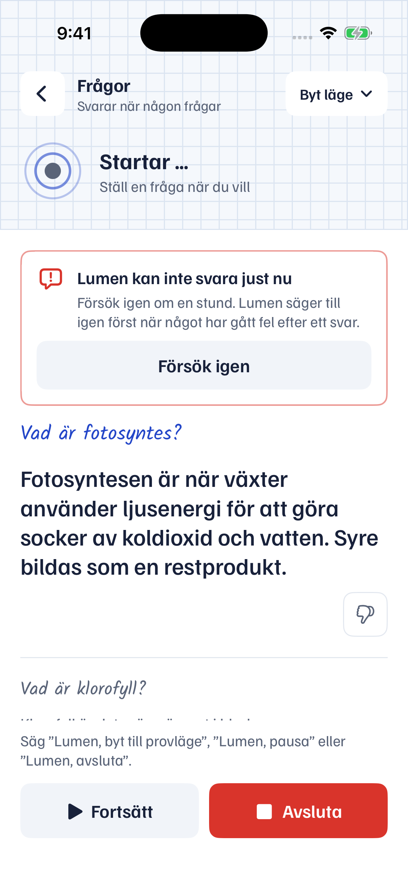
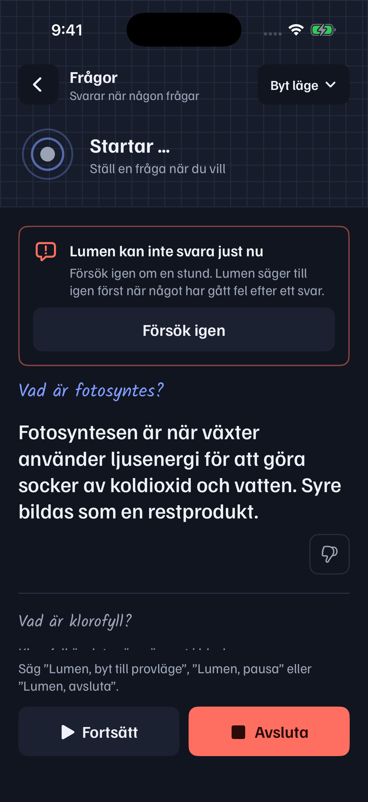
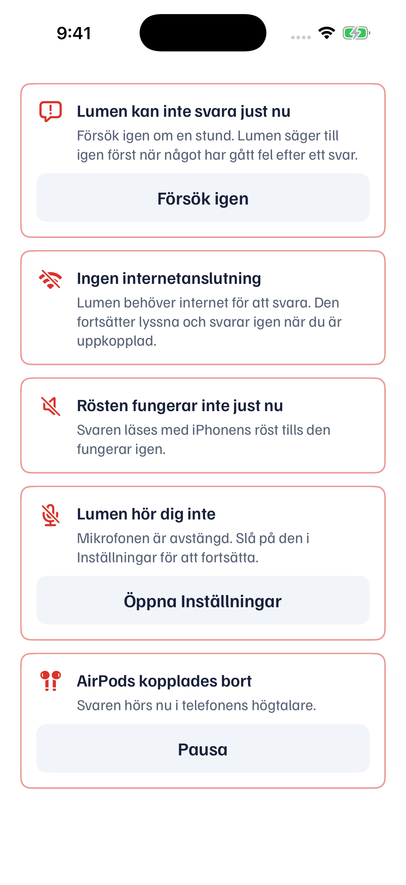

# Angela — A5: Lumen says when it cannot answer

Date: 2026-11-08 · Assignment: `prompts/queue/angela.md` A5 (17:22–17:55 the credits ran out; `/answer` gave 503
`provider_quota`, then 502 `provider_unavailable`; Aron only noticed that "the AI does not answer") · Device:
**none**

**Result:** built. **Unverified on device.** CI and the screenshot: see the end of this report.

## What happens now
**When `/answer` fails** (credits out, the provider down, too slow, anything else):
- **On the screen:** the card "Lumen kan inte svara just nu, Försök igen om en stund" with *Försök igen*.
- **In the ear:** "Jag kan inte svara just nu, försök igen om en stund."

**When there is no network:** "Ingen internetanslutning", the same way.

**Said once:**
- The line is said once per problem. It is not said again while the problem goes on.
- An answer that works clears the card, and the next outage is said again.
- This replaces D86's "once per change of problem", which never said it again after a success.

**Always heard:**
- The line is spoken in **Apple's voice** (`Speaker.announce`), so it is heard when ElevenLabs is what failed.
- Silent mode only shows it.

**"Too slow" (a timeout)** is no longer "Ingen internetanslutning" but "Jag kan inte svara just nu" (`URLError.timedOut`
→ `transport`).

**When `/tts` fails:**
- The sentence is read with Apple's voice, as before (D18).
- New: the card "Rösten fungerar inte just nu, Svaren läses med iPhonens röst …", which goes when the chosen voice works
  again.
- Nothing extra is said, since the answer is heard.

**Diagnostik:** Settings → Diagnostik → *Rå transkription och svar* → *Fel* lists every failure with its time,
whether it was `answer` or `tts`, and the code (for example "Answer service: provider_quota — credits (HTTP 503)").
The same line goes to the session log ("Fel (answer): …").

## Tests
`LumenTests/CannotAnswerTests.swift`:
- **Mapping:**
  - 503 `provider_quota`, 502 `provider_unavailable` and a timeout all become "kan inte svara just nu";
  - no network becomes "Ingen internetanslutning";
  - a timeout is no longer "offline".
- **Flow with fake answers:**
  - 503 → the card plus the line in Apple's voice, once;
  - a second 503 → not said again, and both codes are in Diagnostik;
  - a working answer → the card goes;
  - 502 → said again.
- **A timeout** gives the same line.
- **ElevenLabs failing:** the answer is heard in Apple's voice, the voice card is shown, and the failure is logged as
  `tts`.

`LumenTests/DesignTests.swift`: the old expectations follow the new texts.

## Known limits
- **One wording:** for every kind of `/answer` failure the line is the same. The code that tells them apart is only in
  Diagnostik, as the owner asked.
- **A long timeout** (30 s request timeout) means the line comes up to 30 s after the question.

## Screenshot (Simulator, not a device check)
| Lyssnar with the card (light) | Lyssnar with the card (dark) | Every problem card |
|---|---|---|
|  |  |  |

**A wording change after the picture:** the card's second sentence ("Lumen säger till igen först …") read oddly, so it
is now only "Försök igen om en stund." The pictures still show the old sentence.

## CI
- **Green:** build `42503734744` on `220670e`. IPA:
  https://github.com/aronstenlund-code/aronstenlund-airpods-ai/actions/runs/42503734744/artifacts/13627390989
- **Screenshots:** run `42503745098`.
- **Text change:** the change after the picture is built by the next run.

## Next session
A3 when Kevin's K6 is done; otherwise "Väntar på kö".
