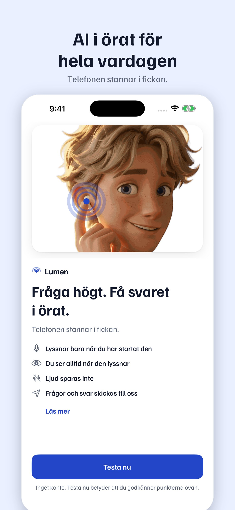

# Kelly Ke25: App Store-sidan, utkast (2026-11-10 20:12)

## Vad som gjordes
- `docs/marketing/appstore/README.md`: underrubrik, reklamtext, beskrivning, nyckelord, kategori,
  förslag på åldersgräns med svaren på Apples frågor, integritetsetiketter som följer samtyckestexten (A41),
  en tabell som jämför varje påstående med appen, och vad som saknas innan något kan skickas in.
- Sex skärmbilder i två storlekar: `docs/marketing/appstore/69-1…6.jpg` (6,9", 1320×2868) och `61-1…6.jpg`
  (6,1", 1179×2556). De görs med `_src/appstore.py` ur CI-körningen "Simulator screenshots" 42876421405 (grön, artefakt `simulator-screenshots-42876421405`) på iPhone 17 Pro Max,
  som jag startade för det här (workflow_dispatch).
- Samordning med Ryans Ke22: slutbilden (hans regel 6, ADS.md regel 19) i 1080×1920 för alla fyra namnen och
  för Lumen, `docs/marketing/annonser/slutbild/`, från `_src/slutbild.py`. Bara ordmärket tills loggan är vald.
  Innehållet hålls ovanför de nedersta 480 px och en bit från högerkanten (säkra ytan, ej verifierat mot
  plattformarnas mallar).

## Beslut (mina, i DECISIONS)
- Skärmbilderna är oförändrade appbilder med en rubrik ovanför, och inga påhittade skärmar.
- Bild 4 visar Byt läge-bladet, så att App Store-sidan säger "mer än plugg" (D118).
- Åldersgräns: förslag 13+ (Apple räknar fram den). Rizz och den nya frågan om dejting och relationer
  (från 16 nov 2026) är osäkra, och Aron avgör.

## Bilderna
| # | Rubrik | Skärm |
|---|---|---|
| 1 | AI i örat för hela vardagen | Intro med Elias |
| 2 | Förhör mig inför provet | Start (D97:s två knappar) |
| 3 | Svaret hörs i örat och syns här | Provläget lyssnar |
| 4 | Plugg, intervju, socialt och Rizz | Byt läge |
| 5 | Övningsprov med rösten | Övningsprovet |
| 6 | Öva inför intervjun | Intervjuläget |

Källbilderna är 1320×2868, som ger 6,9" utan skalning. 6,1" är nedskalad (1179×2556, samma format inom 0,3 %).
JPEG 105–255 kB per bild. Jag bytte Röst-sidan mot Intervjuläget som bild 6, så att två bilder visar mer än plugg.
Röst-sidan finns kvar i CI-artefakten om Aron vill ha den.

## Test
- Alla 12 bilderna öppnade och granskade visuellt. Storlekarna kontrollerade med PIL (1320×2868 och 1179×2556).
- CI-körningen gav 36 bilder (18 skärmar, ljust och mörkt) och ingen kraschrapport.
- Teckenantal räknade med Python: underrubrik 29/30, reklamtext 142/170, beskrivning 1 430/4 000,
  nyckelord 91 tecken / 97 byte (av 100).
- Länkarna i svaren öppnas utanför appen med SwiftUI `Link` (`ListeningScreen.swift:595`). **Verifierat i koden.**
- Allt i appen är **verifierat i simulator/CI, inte på enhet** (se tabellen i README).
- ElevenLabs: 0 tecken. API: 0 USD. CI: en macOS-körning för skärmbilderna.

## Risker och begränsningar
- **Ingen integritetspolicy finns**, och Apple kräver en. Det stoppar inlämningen.
- "Svaren kräver internet" följer samtyckestexten, men A40 svarar kort utan nät på telefoner med Apple Intelligence.
  Angela bör ändra samtycket eller så stryker vi raden.
- "Kopplad till dig" för frågorna beror på om servern sparar inloggningens id: Kevin bekräftar.
- Bild 1 och 2 visar "Lumen" och radiovågssymbolen. De byts när namn och logga är klara.
- I bild 1 trycker Elias på en liten vit hörlur. Det är appens godkända introbild, men en granskare kan se den som
  Apple-lik (5.2.5). Om det blir ett problem: börja med bild 2.
- Demodata syns i bilderna ("Biologiprovet", "5 dagar kvar"). Det är tillåtet, men datumen ska stämma vid inlämning.

## Till Aron
1. Åldersgräns: 13+ med "Dejting och relationer: Nej" (rekommenderar), eller 18+ om du vill vara säker med Rizz.
2. En integritetspolicy behövs innan App Store. Jag kan skriva den som `site/integritet.html` när du sagt ja.
3. Namn och logga (Ke23/Ke24) styr bild 1–2 och texterna ([NAMN]).

## Nästa
Ke24 när Aron valt nummer. Kön har annars bara punkter som väntar, så nästa är stående uppgift (PLAN 2b): granska
Angelas A46-bilder mot SYSTEM.md.
